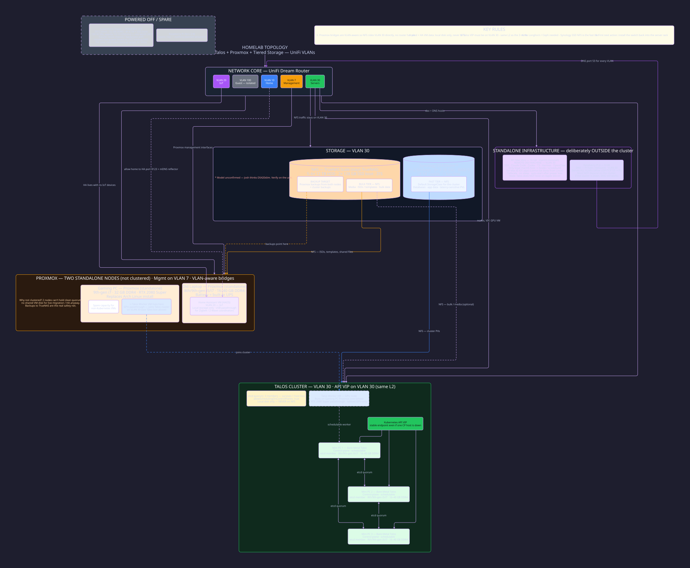

## My Homelab Diagram

Homelab topology: bare-metal Talos, standalone Proxmox, tiered NAS storage, and UniFi VLANs.

[](assets/homelab-diagram.svg)

Edit [homelab-diagram.d2](homelab-diagram.d2), then regenerate the SVG with [D2](https://d2lang.com/) (rendered with v0.9.0):

```sh
d2 --layout elk --theme 200 homelab-diagram.d2 assets/homelab-diagram.svg
```

Created in [T3 Code](https://t3.codes).
