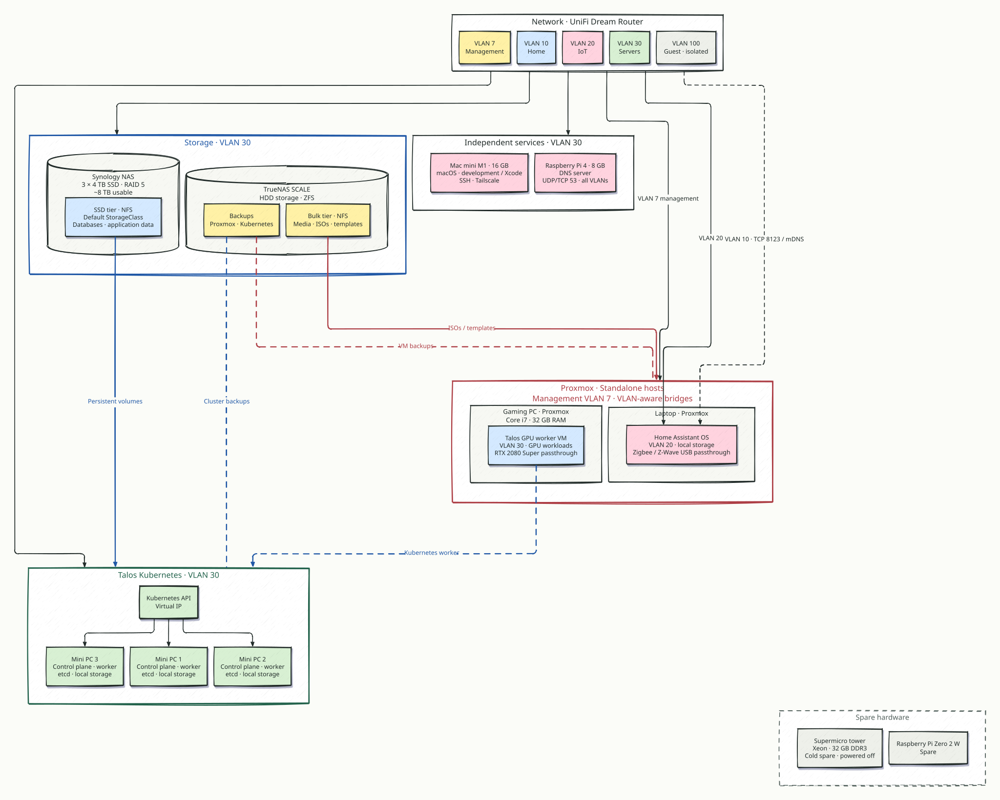

## My Homelab Diagram

Homelab topology: bare-metal Talos, standalone Proxmox, tiered NAS storage, and UniFi VLANs.

**Zoom and pan:** download [viewer.html](viewer.html) using GitHub's **Download raw file** button, then open it in your browser. After cloning the repo, open `viewer.html` directly. It works offline with no server or extra packages.

Drag to pan, scroll or pinch to zoom, and use **Fit diagram** to see the whole topology. Keyboard controls: arrow keys to pan, `+` / `-` to zoom, `F` to fit, and `0` for actual size.

[](assets/homelab-diagram.svg)

The diagram is hand-drawn in D2's sketch mode, in two palettes that match joshrnoll.com: a light whiteboard and a dark chalkboard. Edit the topology in [topology.d2](topology.d2) and the colors in [palettes/](palettes/), then render both SVGs with [D2](https://d2lang.com/) v0.9.0:

```sh
./scripts/render.sh   # or D2=/path/to/d2 ./scripts/render.sh
```

The script downloads the Kalam handwriting font into `.fonts/` on first run, renders `assets/homelab-diagram.svg` (light) and `assets/homelab-diagram-dark.svg` (dark), and rebuilds `viewer.html`. The viewer embeds both and follows `?theme=light|dark`, then the embedding page's theme toggle, then the OS setting. To change the viewer controls or layout, edit [scripts/viewer-template.html](scripts/viewer-template.html) and rebuild it.

Created in [T3 Code](https://t3.codes).
